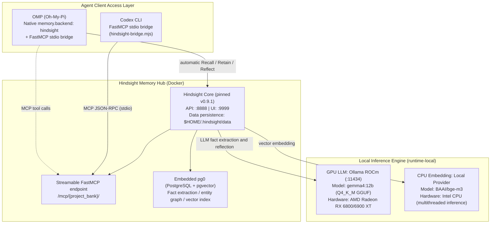

---
{
  "archiveId": "X-1033",
  "title": "Hindsight Local Compute Allocation and Dockerized Deployment",
  "en": "ENGINEERING NOTES",
  "category": "AI 工具",
  "department": "工程笔记",
  "date": "2026-08-22",
  "lead": "DavidHLPL",
  "clearance": "PUBLIC",
  "abstract": "Documents the local compute split for the Vectorize Hindsight memory hub (AMD GPU inference plus CPU embedding), the UID 1000 permission model, and Docker Compose container orchestration.",
  "findings": [
    "Original document: src/content/note/en/hindsight-local-deployment.md",
    "Source revision: f49953fb0d4bd52a39bf81167b0c4b7dd7d78a64",
    "Evidence status: active"
  ],
  "source": "https://github.com/DavidHLP/DavidHLP.github.io/blob/f49953fb0d4bd52a39bf81167b0c4b7dd7d78a64/src/content/note/en/hindsight-local-deployment.md",
  "pubDate": "2026-08-22T16:00:00.000Z",
  "tags": [
    "Hindsight",
    "Docker",
    "Ollama",
    "ROCm",
    "BGE-M3",
    "Architecture",
    "en",
    "note"
  ],
  "draft": false,
  "lang": "en",
  "legacy": {
    "path": "src/content/note/en/hindsight-local-deployment.md",
    "revision": "f49953fb0d4bd52a39bf81167b0c4b7dd7d78a64",
    "metadata": {
      "title": "Hindsight Local Compute Allocation and Dockerized Deployment",
      "timestamp": "2026-08-23 00:00:00+08:00",
      "series": "OMP & Agent Engineering",
      "kind": "concept",
      "status": "active",
      "sources": [
        "hindsight-local-deployment-and-agent-integration"
      ],
      "related": [
        "hindsight-omp-codex-integration",
        "hindsight-troubleshooting",
        "mcp-codebase-memory-workflow"
      ],
      "tags": [
        "Hindsight",
        "Docker",
        "Ollama",
        "ROCm",
        "BGE-M3",
        "Architecture"
      ],
      "description": "Documents the local compute split for the Vectorize Hindsight memory hub (AMD GPU inference plus CPU embedding), the UID 1000 permission model, and Docker Compose container orchestration.",
      "toc": true
    }
  },
  "kind": "concept",
  "status": "active",
  "sources": [
    "hindsight-local-deployment-and-agent-integration"
  ],
  "related": [
    "hindsight-omp-codex-integration",
    "hindsight-troubleshooting",
    "mcp-codebase-memory-workflow"
  ]
}
---

This page records the **compute-allocation architecture and container deployment** of Vectorize Hindsight on Linux. The source reports local daily inference and memory access, focusing on GPU LLM + CPU embedding, persistence permissions, and service lifecycle orchestration. Fully offline operation still requires all models cached and no external provider dependencies.

> **Scope and review (2026-09-08)**: This preserves the v0.9.1 deployment reported in the 2026-08-17 raw. Compose, model import, and health checks were not executed in that revision. Ollama uses the mutable `rocm` tag; driver versions, model revisions/checksums, and reranker are not fully pinned. This is not a directly reproducible version lock. Model names and successful execution are source reports; current availability is unverified.

---

## 1. System Architecture and Runtime Topology

The system has compute, memory hub, and Agent layers. Compose binds published host ports to `127.0.0.1`; containers communicate through the Compose network and `ollama-gpu` service name, not exclusively host loopback. Port binding does not prevent container egress.



### Core design principles

1. **Compute allocation**:
    - **GPU LLM**: The source describes local alias `gemma4:12b` as a 12B Q4_K_M model for Fact Extraction and Reflection. Model identity and VRAM usage require independent confirmation.
    - **CPU embedding**: `BAAI/bge-m3` is configured for CPU to reduce VRAM competition, without guaranteeing LLM stability at arbitrary context lengths.
2. **Local data lifecycle**:
    - Database, Hugging Face cache, and Ollama data are mounted under `$HOME/.hindsight/`. Client transcripts and Docker logs are not all governed by these mounts. Compose does not explicitly pin the reranker or where it runs.

---

## 2. Deployment Steps

### 1. Persistent Directory Planning and Permissions

The source records a container process using UID 1000, which needs writable mounts. **A non-root container user is not Docker Rootless mode**; Rootless/user namespaces change host UID mapping ([Docker Rootless](https://docs.docker.com/engine/security/rootless/)). These historical ownership commands apply only after confirming no UID remapping, dedicated deployment directories, and matching container UID/GID. Do not apply them blindly to shared existing data.

```bash
mkdir -p ~/.hindsight/data ~/.hindsight/models ~/.hindsight/ollama

# Permissions: assign data and model directories to container UID 1000
sudo chown -R 1000:1000 ~/.hindsight/data ~/.hindsight/models
chmod -R u+rwX,g+rwX ~/.hindsight/data ~/.hindsight/models
```

### 2. Docker Compose (`~/.hindsight/docker-compose.yml`)

Use `${HOME}` or absolute host paths instead of depending on shell `~` expansion in noninteractive environments:

```yaml
services:
    # GPU LLM service: load the model through Ollama ROCm
    ollama-gpu:
        image: ollama/ollama:rocm
        container_name: hindsight-ollama-gpu
        restart: unless-stopped
        ports:
            - "127.0.0.1:11434:11434"
        environment:
            - HSA_OVERRIDE_GFX_VERSION=10.3.0 # AMD RDNA2 (gfx1030)
            - ROCR_VISIBLE_DEVICES=0
            - OLLAMA_KEEP_ALIVE=-1
        devices:
            - "/dev/kfd:/dev/kfd"
            - "/dev/dri:/dev/dri"
        volumes:
            - ${HOME}/.hindsight/ollama:/root/.ollama
            - ${HOME}/.hindsight/models:/models:ro

    # Hindsight core server (pinned Vectorize.io version)
    hindsight:
        image: ghcr.io/vectorize-io/hindsight:v0.9.1
        container_name: hindsight-server
        restart: unless-stopped
        ports:
            - "127.0.0.1:8888:8888" # API & MCP endpoints
            - "127.0.0.1:9999:9999" # Web UI console
        environment:
            # --- LLM provider (GPU) ---
            - HINDSIGHT_API_LLM_PROVIDER=ollama
            - HINDSIGHT_API_LLM_BASE_URL=http://ollama-gpu:11434/v1
            - HINDSIGHT_API_LLM_MODEL=gemma4:12b
            # --- Embedding provider (CPU) ---
            - HINDSIGHT_API_EMBEDDINGS_PROVIDER=local
            - HINDSIGHT_API_EMBEDDINGS_LOCAL_MODEL=BAAI/bge-m3
            - HINDSIGHT_API_EMBEDDINGS_LOCAL_FORCE_CPU=true
            # --- Model weight downloads (initial fetch needs networking; precached weights permit offline use) ---
            - HF_ENDPOINT=https://huggingface.co
            - HINDSIGHT_API_LOG_LEVEL=info
        volumes:
            - ${HOME}/.hindsight/data:/home/hindsight/.pg0
            - ${HOME}/.hindsight/models:/home/hindsight/.cache/huggingface
        depends_on:
            - ollama-gpu
```

### 3. GGUF Import and Alias Registration

Write `~/.hindsight/models/Modelfile`:

```dockerfile
FROM /models/gemma-4-12b-it-Q4_K_M.gguf
TEMPLATE """{{ if .System }}<start_of_turn>system
{{ .System }}<end_of_turn>
{{ end }}{{ if .Prompt }}<start_of_turn>user
{{ .Prompt }}<end_of_turn>
{{ end }}<start_of_turn>model
{{ .Response }}<end_of_turn>
"""
PARAMETER stop "<start_of_turn>"
PARAMETER stop "<end_of_turn>"
PARAMETER num_ctx 8192
```

Import and verify:

```bash
docker exec -i hindsight-ollama-gpu ollama create gemma4:12b -f /models/Modelfile
docker exec hindsight-ollama-gpu ollama list
```

---

## 3. Applicability and Boundaries

- **Hardware**: The pictured GPU and 16GB VRAM are examples, not universal minimums or a compatibility promise for the same generation. GPU, drivers, ROCm/Ollama, quantization, and context length determine usability; no hardware matrix was tested in that revision.
- **Network**: Published host ports bind to `127.0.0.1`; containers use internal networking. Do not expose unauthenticated services publicly.
- **Cold start**: Initial weights need external networking or an offline cache under `~/.hindsight/models`.

---

## 4. Minimal Verification

1. **Container status**: `docker ps` should show `hindsight-server` and `hindsight-ollama-gpu` Up.
2. **GPU memory**: `docker exec hindsight-ollama-gpu ollama ps` should show `gemma4:12b` fully loaded in GPU VRAM.
3. **Health**: `curl -I http://127.0.0.1:8888/health` should return HTTP 200.

This is a checklist, not results from that revision. Up means running; `ollama list` lists local models, whereas `ollama ps` lists running models ([Ollama CLI](https://docs.ollama.com/cli)). HTTP health does not replace inference and memory write/recall checks. Short-form `depends_on` does not wait for readiness ([Compose startup order](https://docs.docker.com/compose/how-tos/startup-order/)); end-to-end checks must follow model registration and service readiness.

---

## 5. Evidence and Uncertainty

- **Source report**: `hindsight-local-deployment-and-agent-integration` reports successful deployment and one retrieval; Compose maps `/dev/kfd` and `/dev/dri`, with Hindsight v0.9.1. Historical reports are not fresh runtime validation.
- **Synthesis**: Compute allocation, permissions, and Compose form a separate Concept.
- **Unconfirmed**: ROCm driver installation varies across distributions such as Ubuntu, Fedora, and Arch and must fit the host.

---

## 6. Related Pages

- [Hindsight unified memory integration](/blog/legacy/note/en/hindsight-omp-codex-integration/)
- [Hindsight runtime troubleshooting](/blog/legacy/note/en/hindsight-troubleshooting/)
- [MCP Codebase Memory workflow](/blog/legacy/note/en/mcp-codebase-memory-workflow/)

## Sources and related documents

- [hindsight-local-deployment-and-agent-integration](https://github.com/DavidHLP/DavidHLP.github.io/blob/f49953fb0d4bd52a39bf81167b0c4b7dd7d78a64/src/content/raw/zh-cn/hindsight-local-deployment-and-agent-integration.md)
- [Hindsight Unified Memory Access: FastMCP Bridge and Dynamic Multi-Project Routing](/blog/legacy/note/en/hindsight-omp-codex-integration/)
- [Hindsight Runtime Troubleshooting Matrix and Failure Modes](/blog/legacy/note/en/hindsight-troubleshooting/)
- [MCP Protocol Era Boundary and the codebase-memory-mcp v0.10.2 Graph Workflow](/blog/legacy/note/en/mcp-codebase-memory-workflow/)
