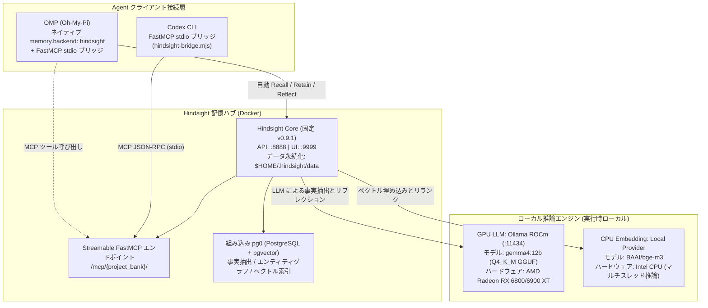

---
{
  "archiveId": "X-1091",
  "title": "Hindsight のローカル計算資源分担と Docker コンテナ化デプロイ",
  "en": "ENGINEERING NOTES",
  "category": "AI 工具",
  "department": "工程笔记",
  "date": "2026-08-22",
  "lead": "DavidHLPL",
  "clearance": "PUBLIC",
  "abstract": "Vectorize Hindsight 記憶ハブのローカル計算資源分担（AMD GPU 推論 + CPU Embedding）、UID 1000 の権限モデル、Docker Compose によるコンテナオーケストレーションを記録する。",
  "findings": [
    "元の文書: src/content/note/ja/hindsight-local-deployment.md",
    "出典リビジョン: f49953fb0d4bd52a39bf81167b0c4b7dd7d78a64",
    "証拠の状態: 有効"
  ],
  "source": "https://github.com/DavidHLP/DavidHLP.github.io/blob/f49953fb0d4bd52a39bf81167b0c4b7dd7d78a64/src/content/note/ja/hindsight-local-deployment.md",
  "pubDate": "2026-08-22T16:00:00.000Z",
  "tags": [
    "Hindsight",
    "Docker",
    "Ollama",
    "ROCm",
    "BGE-M3",
    "Architecture",
    "ja",
    "note"
  ],
  "draft": false,
  "lang": "ja",
  "legacy": {
    "path": "src/content/note/ja/hindsight-local-deployment.md",
    "revision": "f49953fb0d4bd52a39bf81167b0c4b7dd7d78a64",
    "metadata": {
      "title": "Hindsight のローカル計算資源分担と Docker コンテナ化デプロイ",
      "timestamp": "2026-08-23 00:00:00+08:00",
      "series": "OMP と Agent エンジニアリング",
      "kind": "concept",
      "status": "active",
      "sources": [
        "hindsight-local-deployment-and-agent-integration"
      ],
      "related": [
        "hindsight-omp-codex-integration",
        "hindsight-troubleshooting",
        "mcp-codebase-memory-workflow"
      ],
      "tags": [
        "Hindsight",
        "Docker",
        "Ollama",
        "ROCm",
        "BGE-M3",
        "Architecture"
      ],
      "description": "Vectorize Hindsight 記憶ハブのローカル計算資源分担（AMD GPU 推論 + CPU Embedding）、UID 1000 の権限モデル、Docker Compose によるコンテナオーケストレーションを記録する。",
      "toc": true
    }
  },
  "kind": "concept",
  "status": "active",
  "sources": [
    "hindsight-local-deployment-and-agent-integration"
  ],
  "related": [
    "hindsight-omp-codex-integration",
    "hindsight-troubleshooting",
    "mcp-codebase-memory-workflow"
  ]
}
---

本ページは Linux 上の Vectorize Hindsight の**計算資源分担とコンテナ配置**を記録する。出典は日常の推論・記憶アクセスをローカル実行したと報告し、GPU LLM + CPU Embedding、永続化権限、サービス寿命を扱う。完全オフラインには全モデルの cache と外部 provider 依存がないことの確認が必要。

> **範囲と確認（2026-09-08）**：2026-08-17 raw の v0.9.1 配置を保持する。その修訂では Compose、モデル import、健康検査を実行していない。Ollama は可変 `rocm` tag、driver、モデル revision/checksum、reranker は固定不十分で、そのまま再現できる版固定ではない。名称と成功は出典の報告で、現在の可用性は未確認。

---

## 1. 構成と実行トポロジー

計算基盤、記憶中枢、Agent 接続層からなる。Compose は公開 host port を `127.0.0.1` に bind するが、container 間は Compose network と `ollama-gpu` のサービス名を使う。全通信が host loopback を通るわけではなく、port bind は外向き通信を禁止しない。



### 設計原則

1. **資源分担**：
    - **GPU LLM**：出典はローカル別名 `gemma4:12b` を 12B Q4_K_M とし Fact Extraction/Reflection に使用。モデルの実体と VRAM は別途確認する。
    - **CPU Embedding**：`BAAI/bge-m3` を CPU に置いて VRAM 競合を減らす意図。任意の文脈長での安定動作の保証ではない。
2. **データのローカル化**：
    - DB、Hugging Face cache、Ollama data を `$HOME/.hindsight/` に mount。client 転記や Docker log は一括管理されない。reranker と実行場所も Compose では明確に固定していない。

---

## 2. 配置手順

### 1. 永続ディレクトリと権限

出典のプロセス UID は 1000 で、mount への書き込みが必要。**container 内 non-root と Docker Rootless は異なる**。Rootless/user namespace は host UID 対応を変える（[Docker Rootless](https://docs.docker.com/engine/security/rootless/)）。過去の権限コマンドは、再 map なし、専用ディレクトリ、UID/GID 一致を確認した環境限定。共有データへそのまま使わない。

```bash
mkdir -p ~/.hindsight/data ~/.hindsight/models ~/.hindsight/ollama

# 安全权限配置：将数据与模型目录所属权赋予容器 UID 1000
sudo chown -R 1000:1000 ~/.hindsight/data ~/.hindsight/models
chmod -R u+rwX,g+rwX ~/.hindsight/data ~/.hindsight/models
```

### 2. Docker Compose（`~/.hindsight/docker-compose.yml`）

非対話環境の shell `~` 展開に頼らず、host path に `${HOME}` または絶対パスを使う。

```yaml
services:
    # GPU LLM 服务：通过 Ollama ROCm 加载模型
    ollama-gpu:
        image: ollama/ollama:rocm
        container_name: hindsight-ollama-gpu
        restart: unless-stopped
        ports:
            - "127.0.0.1:11434:11434"
        environment:
            - HSA_OVERRIDE_GFX_VERSION=10.3.0 # AMD RDNA2 (gfx1030)
            - ROCR_VISIBLE_DEVICES=0
            - OLLAMA_KEEP_ALIVE=-1
        devices:
            - "/dev/kfd:/dev/kfd"
            - "/dev/dri:/dev/dri"
        volumes:
            - ${HOME}/.hindsight/ollama:/root/.ollama
            - ${HOME}/.hindsight/models:/models:ro

    # Hindsight 核心服务端 (Vectorize.io 固定版本)
    hindsight:
        image: ghcr.io/vectorize-io/hindsight:v0.9.1
        container_name: hindsight-server
        restart: unless-stopped
        ports:
            - "127.0.0.1:8888:8888" # API & MCP 端点
            - "127.0.0.1:9999:9999" # Web UI 控制台
        environment:
            # --- LLM 驱动 (GPU) ---
            - HINDSIGHT_API_LLM_PROVIDER=ollama
            - HINDSIGHT_API_LLM_BASE_URL=http://ollama-gpu:11434/v1
            - HINDSIGHT_API_LLM_MODEL=gemma4:12b
            # --- Embedding 驱动 (CPU) ---
            - HINDSIGHT_API_EMBEDDINGS_PROVIDER=local
            - HINDSIGHT_API_EMBEDDINGS_LOCAL_MODEL=BAAI/bge-m3
            - HINDSIGHT_API_EMBEDDINGS_LOCAL_FORCE_CPU=true
            # --- 模型权重下载配置（首发拉取需连网，预缓存后可脱网） ---
            - HF_ENDPOINT=https://huggingface.co
            - HINDSIGHT_API_LOG_LEVEL=info
        volumes:
            - ${HOME}/.hindsight/data:/home/hindsight/.pg0
            - ${HOME}/.hindsight/models:/home/hindsight/.cache/huggingface
        depends_on:
            - ollama-gpu
```

### 3. GGUF import と別名登録

`~/.hindsight/models/Modelfile` を作る。

```dockerfile
FROM /models/gemma-4-12b-it-Q4_K_M.gguf
TEMPLATE """{{ if .System }}<start_of_turn>system
{{ .System }}<end_of_turn>
{{ end }}{{ if .Prompt }}<start_of_turn>user
{{ .Prompt }}<end_of_turn>
{{ end }}<start_of_turn>model
{{ .Response }}<end_of_turn>
"""
PARAMETER stop "<start_of_turn>"
PARAMETER stop "<end_of_turn>"
PARAMETER num_ctx 8192
```

import と確認：

```bash
docker exec -i hindsight-ollama-gpu ollama create gemma4:12b -f /models/Modelfile
docker exec hindsight-ollama-gpu ollama list
```

---

## 3. 適用条件と境界

- **ハードウェア**：図の GPU と 16GB VRAM は例で、一般的最低条件や同世代互換の保証ではない。GPU、driver、ROCm/Ollama、量子化、文脈長に依存し、その修訂では機種行列を検証していない。
- **ネットワーク**：公開 host port は `127.0.0.1`、container 間は内部網。未認証サービスを公開しない。
- **初回**：weight は外部網または `~/.hindsight/models` の事前 cache が必要。

---

## 4. 最小検証

1. `docker ps` で `hindsight-server` と `hindsight-ollama-gpu` の Up を確認。
2. `docker exec hindsight-ollama-gpu ollama ps` で `gemma4:12b` が GPU VRAM に全て載ることを確認。
3. `curl -I http://127.0.0.1:8888/health` が HTTP 200。

これは実施候補で、その修訂の結果ではない。Up は稼働のみ。`ollama list` はローカル一覧、`ollama ps` は実行中一覧（[CLI 文書](https://docs.ollama.com/cli)）。HTTP 健康は推論・書き込み・検索の代用ではない。短い `depends_on` は ready を待たない（[Compose 起動順](https://docs.docker.com/compose/how-tos/startup-order/)）。登録・準備後に E2E を行う。

---

## 5. 証拠と不確実性

- **出典報告**：`hindsight-local-deployment-and-agent-integration` が配置成功と一回の検索を記録。Compose は `/dev/kfd`、`/dev/dri`、Hindsight v0.9.1 を使う。過去報告を今回の実測に昇格させない。
- **総合**：資源分担、権限、Compose を独立 Concept に整理。
- **未確認**：Ubuntu/Fedora/Arch 等で ROCm driver 導入が異なり host に合わせる。

---

## 6. 関連ページ

- [Hindsight 統一記憶接続](/blog/legacy/note/ja/hindsight-omp-codex-integration/)
- [Hindsight 実行時障害調査](/blog/legacy/note/ja/hindsight-troubleshooting/)
- [MCP Codebase Memory](/blog/legacy/note/ja/mcp-codebase-memory-workflow/)

## 出典と関連文書

- [hindsight-local-deployment-and-agent-integration](https://github.com/DavidHLP/DavidHLP.github.io/blob/f49953fb0d4bd52a39bf81167b0c4b7dd7d78a64/src/content/raw/zh-cn/hindsight-local-deployment-and-agent-integration.md)
- [Hindsight 統合メモリアクセス：FastMCP ブリッジと動的マルチプロジェクトルーティング](/blog/legacy/note/ja/hindsight-omp-codex-integration/)
- [Hindsight ランタイムトラブルシューティングマトリクスと失敗モード](/blog/legacy/note/ja/hindsight-troubleshooting/)
- [MCP プロトコル時代の境界と codebase-memory-mcp v0.10.2 のグラフワークフロー](/blog/legacy/note/ja/mcp-codebase-memory-workflow/)
