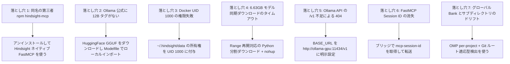

---
{
  "archiveId": "X-1093",
  "title": "Hindsight ランタイムトラブルシューティングマトリクスと失敗モード",
  "en": "ENGINEERING NOTES",
  "category": "AI 工具",
  "department": "工程笔记",
  "date": "2026-08-22",
  "lead": "DavidHLPL",
  "clearance": "PUBLIC",
  "abstract": "Hindsight のローカルデプロイと Agent 統合における典型的な 7 つの失敗モード（誤パッケージ、権限、タイムアウト、ルーティング、Session 消失、ワークスペースドリフト）と調査マトリクスをまとめる。",
  "findings": [
    "元の文書: src/content/note/ja/hindsight-troubleshooting.md",
    "出典リビジョン: f49953fb0d4bd52a39bf81167b0c4b7dd7d78a64",
    "証拠の状態: 有効"
  ],
  "source": "https://github.com/DavidHLP/DavidHLP.github.io/blob/f49953fb0d4bd52a39bf81167b0c4b7dd7d78a64/src/content/note/ja/hindsight-troubleshooting.md",
  "pubDate": "2026-08-22T16:00:00.000Z",
  "tags": [
    "Hindsight",
    "Troubleshooting",
    "Docker",
    "Permissions",
    "FastMCP",
    "Ollama",
    "ja",
    "note"
  ],
  "draft": false,
  "lang": "ja",
  "legacy": {
    "path": "src/content/note/ja/hindsight-troubleshooting.md",
    "revision": "f49953fb0d4bd52a39bf81167b0c4b7dd7d78a64",
    "metadata": {
      "title": "Hindsight ランタイムトラブルシューティングマトリクスと失敗モード",
      "timestamp": "2026-08-23 00:00:00+08:00",
      "series": "OMP と Agent エンジニアリング",
      "kind": "concept",
      "status": "active",
      "sources": [
        "hindsight-local-deployment-and-agent-integration"
      ],
      "related": [
        "hindsight-local-deployment",
        "hindsight-omp-codex-integration",
        "omp-hook-extension-guide"
      ],
      "tags": [
        "Hindsight",
        "Troubleshooting",
        "Docker",
        "Permissions",
        "FastMCP",
        "Ollama"
      ],
      "description": "Hindsight のローカルデプロイと Agent 統合における典型的な 7 つの失敗モード（誤パッケージ、権限、タイムアウト、ルーティング、Session 消失、ワークスペースドリフト）と調査マトリクスをまとめる。",
      "toc": true
    }
  },
  "kind": "concept",
  "status": "active",
  "sources": [
    "hindsight-local-deployment-and-agent-integration"
  ],
  "related": [
    "hindsight-local-deployment",
    "hindsight-omp-codex-integration",
    "omp-hook-extension-guide"
  ]
}
---

Hindsight のローカル配置・Agent 接続の**七つの過去障害、診断、対処記録**を、類似環境の調査用に整理する。

> **範囲と確認（2026-09-08）**：2026-08-17 取得の v0.9.1 raw に基づき、個別の発生時刻はない。その修訂は公式 protocol・Docker・Ollama 文書と照合し、配置、取得、アンインストール、記憶書き込みは実行していない。過去の成否は出典報告で、現行版の一般則や本番証明ではない。

---

## 1. 7 つの典型的な失敗モードと調査マトリクス



### 1. 同名の第三者 npm パッケージを誤ってインストールする（`hindsight-mcp`）

- **現象**：`npm install -g hindsight-mcp` 後、README が `https://api.hindsight-ai.com`、PAT Token、Agent UUID を要求し、`create_memory_block` などのツールを定義する。Vectorize のオープンソースエンドポイントには接続できない。
- **根本原因**：npm リポジトリには同名の古い第三者パッケージが存在するが、Vectorize Hindsight の公式成果物ではない。Vectorize Hindsight は FastMCP サービスを内蔵している。
- **解決策**：npm パッケージを完全にアンインストールし、Hindsight が提供するネイティブ `/mcp/{bank}/` エンドポイントへ直接接続する。
- **予防策**：オープンソースプロジェクト周辺のツールを導入する前に、公式リポジトリのエクスポートプロトコルと統合ディレクトリ（`hindsight-integrations/` など）を確認する。

### 2. 過去の要求で `gemma4:12b` が見つからない

- **現象**：LLM 接続検査が `ApiStatusError(ollama/gemma4:12b): HTTP 404: {"message": "model 'gemma4:12b' not found"}`。
- **証拠境界**：要求先の Ollama にその名前がないことだけを示す。raw は公式 tag 不在を報告するが Registry snapshot はなく、特定サイズしかなかったことや現在の可用性は導けない。
- **過去の対処**：GGUF と Modelfile でローカル別名 `gemma4:12b` を作成。任意の別名は実アーキテクチャ、パラメーター数、公式性を証明しない。元ファイル名と手順は [配置ページ](/blog/legacy/note/ja/hindsight-local-deployment/) に保持。
- **再現条件**：model card、出典 revision、license、checksum、chat template を確認して import を選ぶ。その修訂では実体と現在の URL を確認せず、新しいダウンロード手順は提供しない。

### 3. non-root コンテナの mount 権限（UID 1000）

表は出典の叙述を保持する。tag 不在、取得成功、仮 Bank 削除、検査成功は当時の報告で、その修訂で再証明していない。

- **現象**：`[FAIL] The embedded database directory /home/hindsight/.pg0 is not writable by this container (UID 1000).` で終了。
- **原因**：image は non-root `hindsight`（UID 1000）で動く。host 作成ディレクトリが container の pg0 から書けない場合がある。
- **対処**：mount 先、container UID/GID、host 対応を先に確認し、専用ディレクトリに権限を与える。過去の `chown 1000:1000` は mapping 確認済みが前提。UID 1000 は Rootless daemon を意味せず、[Rootless](https://docs.docker.com/engine/security/rootless/) は user namespace も使うため host/container UID 一致を仮定しない。[配置条件](/blog/legacy/note/ja/hindsight-local-deployment/) を参照。
- **予防**：non-root image の host mount は UID・権限を検査し、一律 777 にしない。

### 4. 大容量モデルファイル（6.63GB）のダウンロードタイムアウト

- **現象**：Agent ツールから同期的にダウンロードすると 300 秒のタイムアウトを超え、中途半端な一時ファイルが残る。
- **根本原因**：モデルウェイトは大きく、国際ネットワーク帯域も制限されるため、同期ブロッキング要求はプロセスマネージャーや CLI クライアントのタイムアウトで簡単に終了させられる。
- **解決策**：`urllib.request` と HTTP `Range` ヘッダーを使う専用 Python ダウンローダーで再開可能にし、`nohup python3 ... > download.log 2>&1 &` でバックグラウンド実行する。
- **予防**：サイズ・帯域・timeout 予算で方式を選び、1GB を一般閾値にしない。過去の `nohup` は process supervision ではない。Range 対応と最終ファイルを検査し、エラー本文を weight に追記しない。

### 5. Ollama API の Base URL に `/v1` がない

- **現象**：`HINDSIGHT_API_LLM_BASE_URL=http://ollama-gpu:11434` と設定すると Hindsight が接続できない。
- **根本原因**：Hindsight の `llm_wrapper.py` は `ollama` provider に対して OpenAI 互換プロトコルを使い、デフォルトで `/v1` 以下にリクエストを組み立てる。カスタムコンテナホスト名で `/v1` を省くと 404 になる。
- **解決策**：Docker Compose の環境変数に `/v1` を含む完全な URL を明示する：`HINDSIGHT_API_LLM_BASE_URL=http://ollama-gpu:11434/v1`。
- **予防**：実 provider/SDK の URL 結合規則を確認。`/v1` は出典環境の修正であり、全 client に一律追加しない。

`http://localhost:11434/v1` は出典の互換 endpoint の例である。

### 6. FastMCP の Session ID 不足による `Bad Request (-32600)`

- **現象**：簡易 stdio ブリッジの最初の `initialize` は成功するが、その後の `tools/list` や `tools/call` が `Bad Request: Missing session ID` を返す。
- **根本原因**：Hindsight は Streamable FastMCP を使う。最初の `initialize` ハンドシェイク成功後、サーバーはレスポンスヘッダーに `mcp-session-id` を返すため、以後のすべての JSON-RPC POST はこの Session ID を HTTP ヘッダーで転送しなければならない。
- **解決策**：Node.js ブリッジに軽量な状態管理を追加し、最初のレスポンスから `mcp-session-id` を取得して後続要求に付与する。
- **予防**：[MCP 2025-06-18](https://modelcontextprotocol.io/specification/2025-06-18/basic/transports) では server が Session ID を割り当てた場合に後続転送が必要。header は契約の一部で、SSE・通知・復旧の不足は [接続ページ](/blog/legacy/note/ja/hindsight-omp-codex-integration/) を参照。

### 7. グローバルなハードコード Bank とサブディレクトリのルーティングドリフト

- **現象**：`bank: ulticode` のハードコードは別プロジェクトの開発時に事実を汚染する。`process.cwd()` だけで名前を求めると、サブディレクトリ内でプロジェクトを誤認し、メモリが分断される。
- **根本原因**：モノリス／マルチモジュール（Monorepo）プロジェクトでは、作業ディレクトリ（CWD）がサブモジュールの深い階層になることが多く、現在のディレクトリ名は Git リポジトリの実体を表さない。また OMP の `per-project-tagged` モードと Codex の独立 Bank ではルーティングの意味が異なる。
- **過去の対処**：OMP は `hindsight.scoping: per-project`、bridge は Git root basename を使用。同一 repo の子階層ずれは解決しても、同名・正規化衝突は残り、一意 ID ではない。
- **予防**：両 client の実 Bank を照合し必要なら別 ID を明示。非 Git fallback・論理分割は [接続ページ](/blog/legacy/note/ja/hindsight-omp-codex-integration/) を参照。

---

## 2. 高速ヘルスチェック SOP

次のコマンドを順番に実行して、基盤と Agent の状態を確認する：

```bash
# 1. GPU 推論コンテナの状態を確認
docker logs hindsight-ollama-gpu | tail -n 20

# 2. 実行中モデルと読み込み情報（事前にロード）
docker exec hindsight-ollama-gpu ollama ps

# 3. Hindsight コアサーバーのログとヘルスを確認
docker logs hindsight-server | tail -n 20
curl -I http://127.0.0.1:8888/health

# 4. 永続化データディレクトリの UID 所有権を確認
ls -la ~/.hindsight/data/

# 5. 構文のみ。起動・handshake 成功の証明ではない
node --check ~/.hindsight/hindsight-bridge.mjs
```

---

`ollama list` はローカル、`ollama ps` は実行中の一覧（[CLI](https://docs.ollama.com/cli)）。stdio の入力待ちは検証成功ではない。initialize、通知、tools/list、対象 Bank への制御された書き込み・検索を確認する。その修訂では未実行。

## 3. 6 段階の進化と技術判断のまとめ

| 段階 | 中心タスク | 発見した違反・障害 | 最終解決と成果 |
| :--- | :--- | :--- | :--- |
| **段階 1：要件受領とアーキテクチャ設計** | Hindsight の完全ローカルデプロイ、GPU で Gemma-4 12B、CPU で BGE-M3、OMP と Codex の統合を要求された。 | 最初は第三者 npm パッケージで直接ブリッジできないか調査した。 | Docker Compose の二コンテナ構成（Ollama ROCm（GPU）+ Hindsight Core（CPU pg0/BGE-M3））を確立した。 |
| **段階 2：偽情報の排除** | インストール済みの `hindsight-mcp` npm パッケージを調査した。 | `api.hindsight-ai.com` を指し PAT Token を要求する第三者の古いパッケージだった。 | アンインストールし、Vectorize Hindsight ネイティブの Streamable FastMCP `/mcp/{bank}/` エンドポイントを採用した。 |
| **段階 3：コンテナとモデルの準備** | Docker コンテナを起動しモデルを取得した。 | 1. UID 1000 の書き込み権限不足でコンテナが停止；2. Ollama 公式に `gemma4:12b` タグがない；3. 6.63GB の同期ダウンロードがタイムアウトした。 | 1. UID 1000 にディレクトリ所有権を付与；2. 再開可能なバックグラウンドダウンローダーを作成；3. Modelfile で GGUF インポートを構築した。 |
| **段階 4：通信チャネルの統一** | Hindsight と Ollama の通信、Codex ブリッジを構築した。 | 1. Hindsight の LLM チェックが 404；2. FastMCP ブリッジがハンドシェイク後に `Missing session ID (-32600)` を返した。 | 1. BASE_URL に `/v1` を追加；2. ブリッジに `mcp-session-id` ヘッダーの取得・転送を実装した。 |
| **段階 5：メモリ分離とルーティングの進化** | OMP と Codex のメモリ共有・分離を処理した。 | `ulticode` のハードコードは別プロジェクトを汚染し、`process.cwd()` の直接利用は `/services/app/` サブディレクトリで Bank 名をドリフトさせた。 | 1. OMP に `scoping: per-project` を設定；2. ブリッジを `git rev-parse --show-toplevel` で Git ルートへ遡るようにした。 |
| **段階 6：一時領域の削除と規約のアーカイブ** | テスト用 Bank を削除し、全量検証を行った。 | `codex` と `omp` の一時 Bank を削除し、KB 憲法に従って raw スナップショットを補い Index/Log を更新した。 | 知識ベースの全量検証に合格した（`pnpm kb:lint`、`pnpm check`、`pnpm build`）。 |

---

## 4. 証拠と不確実性

- **ソース事実**：`hindsight-local-deployment-and-agent-integration` の raw 記録には、7 つのトラブルシューティングログ、Docker の状態、Session ID ハンドシェイクの特徴、Git toplevel スクリプトの検証が含まれる。
- **本ページの統合**：トラブルシューティングログと経験を、標準的な失敗モードマトリクスと判断の進化表に抽出した。
- **未確認**：Streamable HTTP は既に SSE を扱う。過去 bridge の長接続・全イベント形式は未実測。model provenance、client 版、非既定環境の証拠も必要。

---

## 5. 関連ページ

- [Hindsight のローカル計算資源分担と Docker コンテナ化デプロイ](/blog/legacy/note/ja/hindsight-local-deployment/)
- [Hindsight 統合メモリアクセス：FastMCP ブリッジと動的マルチプロジェクトルーティング](/blog/legacy/note/ja/hindsight-omp-codex-integration/)
- [OMP Hook 拡張ガイド](/blog/legacy/note/ja/omp-hook-extension-guide/)


## 出典と関連文書

- [hindsight-local-deployment-and-agent-integration](https://github.com/DavidHLP/DavidHLP.github.io/blob/f49953fb0d4bd52a39bf81167b0c4b7dd7d78a64/src/content/raw/zh-cn/hindsight-local-deployment-and-agent-integration.md)
- [Hindsight のローカル計算資源分担と Docker コンテナ化デプロイ](/blog/legacy/note/ja/hindsight-local-deployment/)
- [Hindsight 統合メモリアクセス：FastMCP ブリッジと動的マルチプロジェクトルーティング](/blog/legacy/note/ja/hindsight-omp-codex-integration/)
- [OMP Hook 拡張の概念：意思決定ポイントのヒント、ハードブロック、ステータス橋渡し](/blog/legacy/note/ja/omp-hook-extension-guide/)
