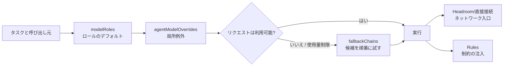

---
{
  "archiveId": "X-1109",
  "title": "OMP 設定の階層：モデルロール、Agent オーバーライド、フォールバックチェーン",
  "en": "ENGINEERING NOTES",
  "category": "AI 工具",
  "department": "工程笔记",
  "date": "2026-07-31",
  "lead": "DavidHLPL",
  "clearance": "PUBLIC",
  "abstract": "OMP 設定を再利用可能な階層モデルとして整理する。modelRoles はロールのデフォルトを選び、agentModelOverrides は局所的な例外を指定し、fallbackChains は障害後に復旧する。Headroom、ルール検出、モデル選択の境界と、順序付き検証方法も示す。",
  "findings": [
    "元の文書: src/content/note/ja/omp-config-and-rules-guide.md",
    "出典リビジョン: f49953fb0d4bd52a39bf81167b0c4b7dd7d78a64",
    "証拠の状態: 有効"
  ],
  "source": "https://github.com/DavidHLP/DavidHLP.github.io/blob/f49953fb0d4bd52a39bf81167b0c4b7dd7d78a64/src/content/note/ja/omp-config-and-rules-guide.md",
  "pubDate": "2026-07-31T16:00:00.000Z",
  "tags": [
    "OMP",
    "Agent",
    "Headroom",
    "DevOps",
    "LLM",
    "Operations",
    "RTK",
    "Rules",
    "Configuration",
    "Architecture",
    "ja",
    "note"
  ],
  "draft": false,
  "lang": "ja",
  "legacy": {
    "path": "src/content/note/ja/omp-config-and-rules-guide.md",
    "revision": "f49953fb0d4bd52a39bf81167b0c4b7dd7d78a64",
    "metadata": {
      "title": "OMP 設定の階層：モデルロール、Agent オーバーライド、フォールバックチェーン",
      "timestamp": "2026-08-01 00:00:00+08:00",
      "series": "OMP と Agent エンジニアリング",
      "kind": "concept",
      "status": "active",
      "draft": true,
      "sources": [
        "legacy-omp-config-and-rules-guide"
      ],
      "related": [
        "headroom-single-port-evolution",
        "omp-headroom-persistence",
        "omp-hook-extension-guide",
        "llm-wiki-pattern"
      ],
      "tags": [
        "OMP",
        "Agent",
        "Headroom",
        "DevOps",
        "LLM",
        "Operations",
        "RTK",
        "Rules",
        "Configuration",
        "Architecture"
      ],
      "description": "OMP 設定を再利用可能な階層モデルとして整理する。modelRoles はロールのデフォルトを選び、agentModelOverrides は局所的な例外を指定し、fallbackChains は障害後に復旧する。Headroom、ルール検出、モデル選択の境界と、順序付き検証方法も示す。",
      "toc": true
    }
  },
  "kind": "concept",
  "status": "active",
  "sources": [
    "legacy-omp-config-and-rules-guide",
    "omp-17-2-15-runtime-contract",
    "omp-17-2-15-runtime-contract-correction"
  ],
  "related": [
    "headroom-single-port-evolution",
    "omp-headroom-persistence",
    "omp-hook-extension-guide",
    "llm-wiki-pattern"
  ]
}
---

このページは、OMP にロールルーティング、サブ Agent のオーバーライド、フォールバック、プロキシ、ルールが同時に存在するとき、どの層が何を決めるのかを答える。基本の因果関係は、role のデフォルトを選び、明示された局所オーバーライドを適用し、障害または使用量ポリシーが必要としたときだけフォールバックチェーンへ進む、というものだ。ネットワーク入口と行動ルールは別の責務である。

## コアメカニズム

### 1. 設定階層と因果チェーン



| 層                                  | 解決する問題                                                                  | 明確に解決しない問題                                      |
| ----------------------------------- | ----------------------------------------------------------------------------- | --------------------------------------------------------- |
| `modelRoles`                        | `plan`、`task`、`slow` などのロールに対するデフォルト provider/model と能力帯 | リクエストがプロキシを通るか、資格情報をどう作るか        |
| `task.agentModelOverrides`          | ある Agent またはサブタスクだけのモデル例外                                   | ロールのデフォルトの代替、または障害復旧                  |
| `retry.fallbackChains`              | 障害、レート制限、使用量ポリシー発動後の候補順序                              | provider 設定の修復、候補が利用可能であることの保証       |
| 実行制御（retry、usage-aware など） | retry、冷却、使用量予約、優先モデルへの復帰のタイミング                       | ロールの意味を再定義すること                              |
| Headroom / `models.db`              | provider からネットワーク入口までのルートとプロキシのライフサイクル           | OMP ロールの選択、Agent ルールの注入                      |
| ルールの検出と注入                  | `globs`、条件、`alwaysApply` による制約の適用                                 | モデルルーティングの変更、`paths` の `globs` への自動変換 |

### 2. 選択と復旧の境界

- 能力とコストの意図はロールのデフォルトに置く。一時的な上流 URL をロールの意味に埋め込まない。
- オーバーライドは本当に例外が必要なサブ Agent だけに使う。現行リリースがキーやスコープを認識しない場合、親ロールまたはデフォルトへ戻る可能性があるため、実行結果で確認する。
- フォールバックチェーンは順序付き候補グラフであり、ヘルスチェッカーではない。すべての候補が現在のモデルカタログに存在し、認証を通る必要がある。
- `fallbackRevertPolicy`、usage-aware fallback、retry 回数は復旧タイミングを変えるが、直接接続の provider を Headroom provider に変えるものではない。
- `globs`、条件、`alwaysApply` はルール注入の意味である。設定ファイルの `rules` スイッチがルール検出を置き換えるわけではない。

### 3. OMP 17.2.15 の compaction、snapcompact、TTSR の境界

以下は公式 `17.2.15` schema のキー単位の事実である。圧縮とルールの実行制御を定め、ロールのモデル選択、provider 登録、ネットワーク入口は決めない。利用者が有効にしたことや値を採用したことの証拠でもない。

| 名前空間 | 公式キー | 境界 |
|---|---|---|
| `compaction` | `enabled`, `midTurnEnabled`, `strategy`, `thresholdPercent`, `thresholdTokens`, `handoffSaveToDisk`, `remoteEnabled`, `remoteStreamingV2Enabled`, `reserveTokens`, `keepRecentTokens`, `autoContinue`, `remoteEndpoint`, `v2RetainedMessageBudget`, `idleEnabled`, `idleThresholdTokens`, `idleTimeoutSeconds`, `supersedeReads`, `dropUseless` | 圧縮の時期・方法・保持量。fallback、モデルカタログ、経路設定ではない |
| `snapcompact` | `systemPrompt`, `toolResults`, `shape` | snapcompact 戦略の入力・形状。汎用 provider・Hook 設定ではない |
| `ttsr` | `enabled`, `contextMode`, `interruptMode`, `repeatMode`, `repeatGap`, `builtinRules`, `disabledRules` | ルールの有効化、注入、反復・割り込み。検出やパス一致の証拠ではない |

自動圧縮の `reason` は `threshold`、`overflow`、`idle`、`incomplete` のみ、`action` は `context-full`、`handoff`、`shake`、`snapcompact` のみ。実際の reason/action を記録してから同じ名前空間のキーを調べる。圧縮が起きただけで戦略、閾値、ルール設定を逆算しない。

`CompactionEntry` は要約と保持境界を持つ第一級の会話エントリー。`BranchSummaryEntry` は `/tree` ナビゲーションで捨てられた分岐の文脈を扱う。会話上の意味を説明するもので、永続化、プロキシ、provider の証拠ではない。

### 4. 設定、ルーティング、挙動の順に検証する

1. **構造層**：設定を parse し、キーの型、ロール名、override 先、fallback 参照を確認する。
2. **意思決定層**：新しいセッションで通常ロールとオーバーライド付きサブ Agent を一つずつ呼び、最終 selector を記録する。テキストだけを読まない。
3. **復旧層**：制御された利用不能または rate limit の候補で、fallback 順序、冷却後の復帰、使用量予約を確認し、元のエラーも残す。
4. **圧縮層**：隔離セッションで自動圧縮を観測し、実際の `reason`/`action` を残す。キーの存在や要約だけではイベントの証拠にならない。
5. **入口層**：Headroom を使う場合、`models.db`/明示 custom provider、リクエスト headers、active wrapped session を別々に確認する。200 や `/health` は到達性しか示さない。
6. **ルール層**：`omp ttsr list` と `omp ttsr scan -v <candidate>` で検出とパスへの適用を確認する。

## 適用条件

- 一つの OMP 環境で、計画、実装、デザイン、高速スキャンの負荷を調整したい。
- 全体設定を複製せず、単一のサブ Agent だけモデルを変更したい。
- API の rate limit、使用量枯渇、モデル選択の誤りを分離して診断したい。
- プロキシルートとルールファイルを運用しながら、各層の証拠を残したい。

## 非適用とリスク

| 症状                                     | 誘発されやすい誤診                      | 境界と対応                                                                                 |
| ---------------------------------------- | --------------------------------------- | ------------------------------------------------------------------------------------------ |
| サブ Agent が親モデルを使う              | override キーは必ず効くと思う           | フィールド名、スコープ、継承はリリースで異なる。新しいセッションの最終 selector を確認する |
| 主モデルは成功するが fallback が失敗する | fallback が新しいモデルを発見すると思う | fallback は宣言済み候補だけを歩く。無効、古い、未認証の候補を除く                          |
| 設定を変えても挙動が変わらない           | hot reload だと思う                     | セッション単位のロードは新しいセッションで確認する。古いプロセスは証拠にならない           |
| ルールはロードされるがパスに反応しない   | `globs:` なしで `paths:` を使う           | OMP が読むのは `globs`。共有ディレクトリで両方を持てても自動変換はない                     |
| loopback または HTTP 200 しか見えない    | 到達性を経路全体とみなす                | inbound/outbound ログと最終上流を確認する。ロール選択、入口、圧縮 savings は別の事実である |
| すべてを `alwaysApply` にする            | 繰り返しが安全だと思う                  | sticky ルールは毎ターン文脈を膨らませる。多くの制約にはパスまたはストリーム条件が適する    |

## 最小検証

```text
設定 parse → ロールのデフォルト → override 命中 → fallback → automatic compaction reason/action
          →（使用時）実際の入口/上流 → ルール検出/パス命中
```

最小の有効な証拠は、通常ロール一つの最終 selector、オーバーライド付きサブ Agent 一つの最終 selector、制御された fallback の候補順、自動圧縮一回の実 reason/action、そして scan が報告するルール項目である。静的 YAML だけから推測した結果は、実行時挙動の証明にならない。

## 証拠と不確実性

- **出典の事実**：`legacy-omp-config-and-rules-guide` は `modelRoles`、`task.agentModelOverrides`、`retry.fallbackChains`、ルール正規化、`paths`/`globs` の無言の失敗を記録する。`omp-17-2-15-runtime-contract` は最初の公式 tag を保存し、`omp-17-2-15-runtime-contract-correction` は同一 commit で compaction/snapcompact/ttsr のキー集合と reason/action の閉集合を補足・限定する。
- **総合**：「デフォルト → 局所 override → 復旧 → 圧縮・ルール制御 → ネットワーク入口 → ルール一致」の順に層を分ける。
- **版と未確認事項**：キーとイベント列挙は OMP `17.2.15` のみ。ロール数、CLI、override 優先度、fallback 使用量閾値、`models.db` は版によって変わり得る。古い環境や利用者の値を現在の既定とはしない。

## 関連ページ

- [Headroom 単一ポート移行](/blog/legacy/note/ja/headroom-single-port-evolution/)
- [Headroom ルート永続化](/blog/legacy/note/ja/omp-headroom-persistence/)
- [OMP Hook 拡張](/blog/legacy/note/ja/omp-hook-extension-guide/)
- [LLM wiki pattern](/blog/legacy/note/ja/llm-wiki-pattern/)


## 出典と関連文書

- [legacy-omp-config-and-rules-guide](https://github.com/DavidHLP/DavidHLP.github.io/blob/f49953fb0d4bd52a39bf81167b0c4b7dd7d78a64/src/content/raw/zh-cn/legacy-omp-config-and-rules-guide.md)
- [omp-17-2-15-runtime-contract](https://github.com/DavidHLP/DavidHLP.github.io/blob/f49953fb0d4bd52a39bf81167b0c4b7dd7d78a64/src/content/raw/zh-cn/omp-17-2-15-runtime-contract.md)
- [omp-17-2-15-runtime-contract-correction](https://github.com/DavidHLP/DavidHLP.github.io/blob/f49953fb0d4bd52a39bf81167b0c4b7dd7d78a64/src/content/raw/zh-cn/omp-17-2-15-runtime-contract-correction.md)
- [Headroom 単一ポートの総合：入口、動的上流、検証の境界](/blog/legacy/note/ja/headroom-single-port-evolution/)
- [Headroom ルート永続化の総合：Named Profile、model_cache、復旧](/blog/legacy/note/ja/omp-headroom-persistence/)
- [OMP Hook 拡張の概念：意思決定ポイントのヒント、ハードブロック、ステータス橋渡し](/blog/legacy/note/ja/omp-hook-extension-guide/)
- [LLM-Wiki パターン：LLM で蓄積する個人 AI ナレッジベース](/blog/legacy/note/ja/llm-wiki-pattern/)
